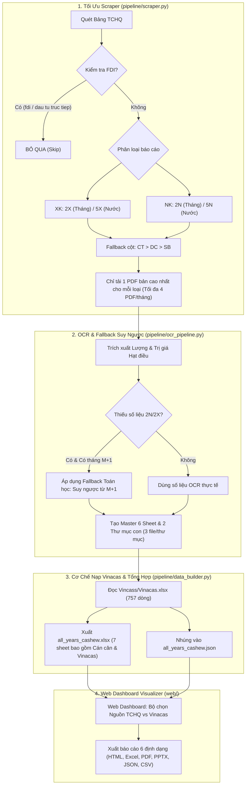

# MASTER PLAN: TỐI ƯU HÓA SCRAPER (LOẠI BỎ FDI, 2 FILE NK/THÁNG), CƠ CHẾ VINACAS & CHUẨN HÓA LAYOUT CÁC LOẠI BÁO CÁO

> **Phiên bản:** 1.0 — Ngày lập: 26/10/2026  
> **Trạng thái:** Sẵn sàng triển khai sau khảo sát toàn diện mã nguồn & phỏng vấn `/grill-me`  
> **Phạm vi tác động:** `pipeline/scraper.py`, `pipeline/ocr_pipeline.py`, `pipeline/data_builder.py`, `main.py`, `docs/`, `output/`

---

## 1. TỔNG QUAN YÊU CẦU & KẾT QUẢ ALIGNMENT (/GRILL-ME)

Qua rà soát chi tiết toàn bộ codebase (`scraper.py`, `ocr_pipeline.py`, `data_builder.py`, `README.md`) và giải quyết các câu hỏi kiến trúc qua `/grill-me`, 4 định hướng kỹ thuật cốt lõi đã được thống nhất:

1. **Loại bỏ triệt để dữ liệu FDI trong quá trình Scraping**:
   - Hiện tại, hàm `_row_kind()` trong `scraper.py` bắt dính cả báo cáo **3N** (*"Hàng hoá nhập khẩu của doanh nghiệp có vốn đầu tư trực tiếp nước ngoài (FDI)"*), **3X** (FDI xuất khẩu) và **4** (Cán cân thương mại FDI).
   - **Quy chuẩn mới:** Scraper chủ động loại trừ mọi tiêu đề có chứa từ khóa FDI (`"fdi"`, `"dau tu truc tiep nuoc ngoai"`, `"doanh nghiep co von"`).
2. **Chuẩn hóa giới hạn đúng 2 file Nhập khẩu / tháng & cơ chế Fallback ưu tiên**:
   - Chỉ thu thập đúng 2 loại báo cáo Nhập khẩu: **2N** (Tổng quan tháng) và **5N** (Chi tiết theo nước).
   - Đồng bộ tương tự cho Xuất khẩu: **2X** (Tổng quan tháng) và **5X** (Chi tiết theo nước).
   - **Cơ chế Fallback phiên bản khi tải (Single Best Version Download):** Thay vì tải tất cả các phiên bản (Sơ bộ, Điều chỉnh, Chính thức), Scraper chỉ tải duy nhất **1 bản có độ ưu tiên cao nhất**:  
     $$\text{Chính thức (CT)} \longrightarrow \text{Điều chỉnh (DC)} \longrightarrow \text{Sơ bộ (SB)}$$
     $\Longrightarrow$ Mỗi tháng chỉ tải tối đa **2 file PDF NK** (1 file 2N + 1 file 5N) và **2 file PDF XK** (1 file 2X + 1 file 5X). Tổng cộng chuẩn đét **4 PDF/tháng**.
3. **Làm rõ & tinh gọn cơ chế nạp dữ liệu Hiệp hội Vinacas**:
   - Toàn bộ 757 bản ghi lịch sử nhập khẩu điều thô (Raw Cashew Nut - RCN) được quản lý độc lập tại `Vincass/Vinacas.xlsx`.
   - Nạp vào toàn bộ hệ thống qua 3 tầng: File Master từng tháng (Sheet `Vinacas_Doi_Chieu`), File tổng hợp đa năm (Sheet `Vinacas`), và JSON Web Dashboard (`vinacas_records`).
4. **Chuẩn hóa Layout tất cả các loại báo cáo đầu ra**:
   - Bổ sung thêm sheet `Can_Can_Thuong_Mai_All` vào `all_years_cashew.xlsx` để đồng bộ 100% với file Master từng tháng.
   - Thư mục con `Xuat_Khau/` và `Nhap_Khau/` giữ nghiêm ngặt quy tắc **đúng 3 file** (1 Excel 3-sheet + 2 PDF mới nhất).

---

## 2. PHÂN TÍCH HIỆN TRẠNG & NGUYÊN NHÂN GÂY LỖI / THỪA DỮ LIỆU

### 2.1. Tại sao Scraper đang cào thừa FDI (3N, 3X, 4)?
Tại `pipeline/scraper.py` (dòng 72–94):
```python
def _row_kind(title, period):
    t = re.sub(r"\s+", " ", _ascii(clean(title)).lower()).strip()
    if not _period_matches(title, period): return "unknown", "unknown"
    t_clean = re.sub(r"[,/]", " ", t)

    # Nhập khẩu
    if "nhap khau" in t_clean:
        if any(k in t_clean for k in ("chia theo mat hang", "mot so nuoc", ...)):
            return "country_product", "import"
        if "thang" in t_clean:
            return "summary", "import"  # <-- LỖI: Tiêu đề 3N "Hàng hóa nhập khẩu của doanh nghiệp FDI tháng 09/2025" khớp điều kiện này!
```
- Khi TCHQ công bố bảng kết quả, dòng 3N và dòng 2N đều chứa `nhap khau` và `thang`.
- Dòng 3X và dòng 2X đều chứa `xuat khau` và `thang`.
- Kết quả: `output/YYYY/YYYY-MM/pdfs/` bị tải thừa cả `3N(VN-CT)`, `3X(VN-CT)`, `4(VN-CT)`, `3N(VN-SB)`, v.v. (lên tới 7-14 file PDF cho 1 tháng).

### 2.2. Tại sao tải thừa nhiều phiên bản PDF cùng lúc?
Tại `fetch_tchq_playwright` và `fetch_tchq_multi_period`:
- Duyệt qua danh sách các cột phiên bản `version_cols = [official, adjusted, preliminary]`.
- Vòng lặp `for ver_key, ver_name, col_idx in version_cols:` thực hiện tải TẤT CẢ các anchor tìm thấy mà không dừng lại sau khi đã tìm thấy phiên bản cao nhất.
- Hậu quả: Nếu kỳ đó có cả bản Chính thức lẫn Sơ bộ, Scraper sẽ tải cả 2 file `VN-CT` và `VN-SB`, gây tốn băng thông, dung lượng đĩa và làm chậm quá trình quét.

---

## 3. MASTER PLAN CHI TIẾT CÁC BƯỚC ĐIỀU CHỈNH



---

## 4. CHI TIẾT KỸ THUẬT CÁC HẠNG MỤC THI CÔNG

### Hạng Mục 1: Điều Chỉnh `pipeline/scraper.py`
1. **Lọc triệt để FDI trong `_row_kind(title, period)`:**
   ```python
   _FDI_EXCLUDE_TERMS = [
       "fdi", "dau tu truc tiep nuoc ngoai", "doanh nghiep co von",
       "von dau tu truc tiep", "doanh nghiep fdi", "thuong mai hang hoa cua doanh nghiep"
   ]
   # Nếu tiêu đề chứa bất kỳ từ khóa FDI nào -> return "unknown", "unknown" ngay lập tức
   ```
2. **Bộ lọc regex nghiêm ngặt cho 4 mã báo cáo chuẩn:**
   - **2X (Xuất khẩu tổng quan tháng):** Chứa `xuat khau` + `hang hoa thang` (hoặc `theo thang`), không chứa `nuoc` / `vung lanh tho` / `mat hang`.
   - **5X (Xuất khẩu theo nước):** Chứa `xuat khau` + (`chia theo mat hang` | `mot so nuoc` | `vung lanh tho`).
   - **2N (Nhập khẩu tổng quan tháng):** Chứa `nhap khau` + `hang hoa thang` (hoặc `theo thang`), không chứa `nuoc` / `vung lanh tho` / `mat hang`.
   - **5N (Nhập khẩu theo nước):** Chứa `nhap khau` + (`chia theo mat hang` | `mot so nuoc` | `vung lanh tho`).
3. **Cơ chế Fallback tải bản đơn lẻ (Single Best Version):**
   - Thứ tự ưu tiên: `[("official", "Chính thức"), ("adjusted", "Điều chỉnh"), ("preliminary", "Sơ bộ")]`.
   - Khi quét 1 dòng báo cáo: Duyệt lần lượt theo thứ tự ưu tiên. Nếu cột **Chính thức** có link/anchor tải $\longrightarrow$ Tải file này và **break ngay** (không tải tiếp Điều chỉnh hay Sơ bộ).
   - Nếu không có Chính thức $\longrightarrow$ Kiểm tra Điều chỉnh $\longrightarrow$ Nếu không có mới tải Sơ bộ.
   - Kết quả: Thư mục `pdfs/` mỗi tháng chỉ chứa tối đa 4 file (2 file XK: 2X, 5X; 2 file NK: 2N, 5N).

---

### Hạng Mục 2: Cơ Chế Fallback Toán Học Cho Nhập Khẩu (`ocr_pipeline.py`)
Khi kỳ $M$ bị thiếu file PDF 2N (hoặc TCHQ chưa công bố file tháng), hệ thống kích hoạt cơ chế suy ngược từ tháng $M+1$ giống hệt luồng Xuất khẩu:
$$Q_M = \frac{Q_{M+1}}{1 + \frac{\%\Delta Q_{M+1}}{100}}, \qquad V_M = \frac{V_{M+1}}{1 + \frac{\%\Delta V_{M+1}}{100}}$$
- `source`: `"TCHQ_Fallback"`
- `version`: `"derived"`
- `is_derived`: `True`
- `source_note`: `"Ước tính suy ngược từ T(M+1) với % thay đổi (Lượng: ...%, Trị giá: ...%)"`
- Tô nền màu vàng nhạt cảnh báo: `#FFF3CD` (RGB 255, 243, 205).

---

### Hạng Mục 3: Cơ Chế Dọn Dẹp File Cũ (`main.py --clean`)
- Thêm cờ `--clean` vào `main.py`.
- Tự động quét và loại bỏ các file rác trong `output/YYYY/YYYY-MM/pdfs/`:
  - Xóa các file có chứa `-3N`, `_3N`, `-3X`, `_3X`, `-4(`, `_4(` (các file FDI cũ).
  - Nếu trong thư mục đã có file `VN-CT` thì tự động xóa bản `VN-SB` dư thừa.

---

### Hạng Mục 4: Cơ Chế Nạp Dữ Liệu Vinacas & Đối Soát Chéo
- **Vị trí tệp nguồn:** `Vincass/Vinacas.xlsx`.
- **Cấu trúc tệp Vinacas (757 bản ghi):**
  - Cột 0: `Tên Nước Data gốc` (tên tiếng Anh / gốc)
  - Cột 1: `Tên quốc gia trong Report` (Việt hóa)
  - Cột 2: `Region` (Châu lục: Africa, Cambodia, Asia, Other...)
  - Cột 3: `Mặt hàng` ("Điều thô" / RCN)
  - Cột 4: `Đơn vị tính` (Tấn)
  - Cột 5: `Lượng` (số thực)
  - Cột 6: `Trị giá (USD)` (số thực)
  - Cột 7: `Fulldate` (Ngày ghi nhận: `YYYY-MM-DD`)
  - Cột 8: `Luồng` ("Import")
- **Quy trình nạp vào hệ thống:**
  1. `data_builder.py`: Đọc 757 dòng, nạp vào key `vinacas_records` của `output/data/all_years_cashew.json`.
  2. `all_years_cashew.xlsx`: Tạo Sheet `Vinacas` lưu nguyên vẹn 757 dòng có AutoFilter và định dạng chuyên nghiệp.
  3. `ocr_pipeline.py`: Khi sinh file Master `{YYYY-MM}_cashew.xlsx`, lọc các bản ghi Vinacas có `Fulldate[:7] == period` để đưa vào Sheet 6 `Vinacas_Doi_Chieu`.
  4. Web Dashboard (`web/app.js`): Khi người dùng bấm nút nguồn `Vinacas`, hệ thống tự động khóa luồng về `Nhập khẩu`, hiển thị KPI lượng/giá trị nhập khẩu điều thô RCN, biểu đồ thị phần khu vực (Africa, Campuchia...) và bản đồ nguồn cung.

---

## 5. BẢNG QUY CHUẨN LAYOUT TẤT CẢ CÁC BÁO CÁO XUẤT RA

### 5.1. File Master Tháng `{YYYY-MM}_cashew.xlsx` (6 Sheet Chuẩn + Sheet Meta)

| STT | Tên Sheet | Cấu Trúc Cột (Header) | Quy Cách Định Dạng & Ghi Chú |
|:---:|:---|:---|:---|
| **1** | `Tong_Quan_XNK` | `STT` \| `Kỳ` \| `Luồng` \| `Mặt hàng` \| `ĐVT` \| **Số trong tháng** (`Lượng`, `Trị giá USD`) \| **So tháng trước** (`% Lượng`, `% Trị giá`) \| **Cộng dồn YTD** (`Lượng`, `Trị giá USD`) \| `Phiên bản` \| `Ghi chú nguồn` | Header 2 tầng (merge A1:A2, F1:G1...). Dòng số liệu định dạng số nguyên `#,##0` và tỷ lệ `0.0%`. Dòng Fallback tô vàng `#FFF3CD`. |
| **2** | `Can_Can_Thuong_Mai` | `STT` \| `Kỳ` \| `Chỉ số / Luồng` \| `ĐVT` \| `Lượng tháng` \| `Trị giá tháng (USD)` \| `Lũy kế lượng` \| `Lũy kế trị giá (USD)` \| `Trạng thái cán cân` | Gồm 3 dòng: Dòng 1 (XK), Dòng 2 (NK), Dòng 3 (Cán cân ròng $Net = XK - NK$, tô màu vàng, gắn nhãn Thặng dư / Thâm hụt). |
| **3** | `XK_Theo_Nuoc` | `Quốc gia` \| `mặt hàng` \| `Đơn vị tính` \| `CY Lượng` \| `CY Trị giá (USD)` \| `YTD Lượng` \| `YTD Trị giá (USD)` | Bóc tách từ báo cáo 5X mới nhất. Sắp xếp giảm dần theo Trị giá tháng. |
| **4** | `NK_Theo_Nuoc` | `Quốc gia` \| `mặt hàng` \| `Đơn vị tính` \| `CY Lượng` \| `CY Trị giá (USD)` \| `YTD Lượng` \| `YTD Trị giá (USD)` | Bóc tách từ báo cáo 5N mới nhất. Danh sách các nước Việt Nam nhập khẩu điều thô. |
| **5** | `Lich_Su_Phien_Ban` | `STT` \| `Kỳ` \| `Luồng` \| `Phiên bản` \| `Mặt hàng` \| `ĐVT` \| `Lượng tháng` \| `Trị giá (USD)` \| `File nguồn` \| `Ghi chú` | Lưu vết đầy đủ các phiên bản thu thập được để đối soát lịch sử. |
| **6** | `Vinacas_Doi_Chieu` | `Kỳ` \| `Tên Nước Data gốc` \| `Tên quốc gia trong Report` \| `Region` \| `Mặt hàng` \| `ĐVT` \| `Lượng` \| `Trị giá (USD)` \| `Luồng (Export/Import)` \| `Nguồn` | Trích xuất các dòng cùng kỳ từ `Vinacas.xlsx` để so sánh đối chiếu với số liệu TCHQ. |
| **7** | `_Meta` | `Key` \| `Value` | Lưu metadata kỹ thuật: ngày tạo, số dòng, phiên bản pipeline. |

---

### 5.2. Hai Thư Mục Con Độc Lập `Xuat_Khau/` và `Nhap_Khau/` (Đúng 3 File Mỗi Folder)

Mỗi tháng sinh ra đúng 2 thư mục nghiệp vụ chuyên biệt:

```
output/YYYY/YYYY-MM/
├── Xuat_Khau/                        # 📁 THƯ MỤC XUẤT KHẨU (ĐÚNG 3 FILE)
│   ├── YYYY-MM_xuat_khau.xlsx        # Excel 3 sheet: Tong_Quan_XK, XK_Theo_Nuoc, Lich_Su_Phien_Ban
│   ├── YYYY-MM-2X(VN-CT).pdf         # PDF tổng quan XK tháng (Bản mới nhất: CT > DC > SB)
│   └── YYYY-MM-5X(VN-CT).pdf         # PDF chi tiết XK theo nước (Bản mới nhất)
│
└── Nhap_Khau/                        # 📁 THƯ MỤC NHẬP KHẨU (ĐÚNG 3 FILE)
    ├── YYYY-MM_nhap_khau.xlsx        # Excel 3 sheet: Tong_Quan_NK, NK_Theo_Nuoc, Lich_Su_Phien_Ban
    ├── YYYY-MM-2N(VN-CT).pdf         # PDF tổng quan NK tháng (Bản mới nhất: CT > DC > SB)
    └── YYYY-MM-5N(VN-CT).pdf         # PDF chi tiết NK theo nước (Bản mới nhất)
```

---

### 5.3. File Tổng Hợp Toàn Bộ Các Năm `output/all_years_cashew.xlsx` (Chuẩn Mới 7 Sheet)

Được bổ sung sheet Cán cân thương mại toàn năm theo kết quả alignment `/grill-me`:

1. **`Tong_Quan_XNK_All`**: Hợp nhất toàn bộ các dòng tổng quan XK và NK của tất cả các kỳ (2020–2026).
2. **`Can_Can_Thuong_Mai_All`** *(Mới)*: Chuỗi thời gian liên tục về Cán cân thương mại ròng hàng tháng ($Val_{XK} - Val_{NK}$, $Qty_{XK} - Qty_{NK}$, thặng dư/thâm hụt).
3. **`XK_Theo_Nuoc_All`**: Toàn bộ dữ liệu chi tiết xuất khẩu theo thị trường qua các năm.
4. **`NK_Theo_Nuoc_All`**: Toàn bộ dữ liệu chi tiết nhập khẩu theo nguồn cung qua các năm.
5. **`Lich_Su_Phien_Ban_All`**: Lịch sử các phiên bản TCHQ đã thu thập.
6. **`Vinacas`**: Toàn bộ 757 dòng dữ liệu gốc từ Hiệp hội Vinacas có AutoFilter.
7. **`Tong_XK_All`**: Sheet tương thích ngược legacy cho luồng xuất khẩu.

---

### 5.4. Hệ Thống Xuất Báo Cáo Web Dashboard (Export UX Kit — 6 Định Dạng)

Tất cả các định dạng được xuất client-side từ Web Dashboard (`web/app.js`) tôn trọng theo nguồn dữ liệu (`TCHQ` hoặc `Vinacas`) và luồng đang chọn (`Xuất khẩu` / `Nhập khẩu` / `Cán cân`):

| Định dạng | Tên tệp xuất mẫu | Layout & Nội dung chính |
|:---|:---|:---|
| **HTML** | `{period}_cashew_{flow}.html` | Báo cáo tự chứa (standalone): Cover Dan On Foods + Khối KPI + Thống kê YoY + Top 10 thị trường + Biểu đồ xu hướng + Bảng chi tiết. Hỗ trợ in PDF chuẩn A4 (Ctrl+P) và chế độ trình chiếu `?slides=1`. |
| **Excel** | `{period}_cashew_{flow}.xlsx` | Tạo qua ExcelJS chuẩn 5 sheet: `Tong_Quan` (kèm banner thương hiệu Dan On Foods) · `XK_Theo_Nuoc` · `NK_Theo_Nuoc` · `Bieu_Do` (chèn ảnh đồ thị native) · `_Meta`. |
| **PDF** | `{period}_cashew_{flow}.pdf` | Tạo qua jsPDF + Font Be Vietnam Pro tiếng Việt chuẩn: Bìa báo cáo sang trọng $\rightarrow$ Khối KPI & Delta Pills $\rightarrow$ Phân tích YoY $\rightarrow$ Biểu đồ Top 10 $\rightarrow$ Bảng phân trang chi tiết. |
| **PPTX** | `{period}_cashew_{flow}.pptx` | Tạo qua PptxGenJS trình chiếu 6+ slide: Slide tiêu đề $\rightarrow$ Slide KPI $\rightarrow$ Slide Top 10 (biểu đồ cột native) $\rightarrow$ Slide cơ cấu khu vực (biểu đồ tròn) $\rightarrow$ Slide xu hướng (đường) $\rightarrow$ Bảng phân trang 17 dòng/slide. |
| **JSON** | `{period}_cashew_{flow}.json` | Payload sạch có cấu trúc chuẩn schema (`periods`, `tong_xk`, `tong_nk`, `versions`, `schema_version: 1`), có thể kéo-thả ngược lại vào Dashboard để phục hồi trạng thái. |
| **CSV** | `{period}_cashew_{flow}.csv` | Bảng phẳng UTF-8 có BOM (mở trực tiếp không lỗi font trên Excel Windows), xuất theo bộ lọc và luồng đang kích hoạt. |

---

## 6. LỘ TRÌNH TRIỂN KHAI & TIÊU CHÍ NGHIỆM THU

### 6.1. Các Bước Thực Hiện
1. **Bước 1: Sửa Scraper (`pipeline/scraper.py`)**:
   - Thêm lọc `_FDI_EXCLUDE_TERMS`.
   - Cập nhật logic tải: Giới hạn tải 1 bản cao nhất (CT > DC > SB), tối đa 2 PDF/tháng cho NK và 2 PDF/tháng cho XK.
2. **Bước 2: Sửa Bộ Điều Phối & Dọn Dẹp (`main.py`)**:
   - Thêm hàm `purge_fdi_pdfs()` tự động dọn sạch các file `3N`, `3X`, `4` cũ trong `output/`.
3. **Bước 3: Cập Nhật Tổng Hợp Đa Năm (`pipeline/data_builder.py`)**:
   - Thêm sheet `Can_Can_Thuong_Mai_All` vào `all_years_cashew.xlsx`.
4. **Bước 4: Kiểm Thử Toàn Diện (End-to-End Verification)**:
   - Chạy thử 1 kỳ đơn lẻ: `python main.py --period 2026-09 --force`.
   - Kiểm tra thư mục `pdfs/` chỉ có đúng 4 file PDF (hoặc 2 file NK).
   - Kiểm tra thư mục `Nhap_Khau/` có đúng 3 file.
   - Chạy `python pipeline/data_builder.py` kiểm tra 7 sheet trong `all_years_cashew.xlsx`.
   - Chạy `python ui_verify.py` kiểm tra tính toàn vẹn của Web Dashboard và Export UX Kit.

### 6.2. Tiêu Chí Nghiệm Thu (Acceptance Criteria)
- [ ] Khi chạy cào mạng, hoàn toàn không còn bất kỳ file PDF nào mang tiền tố hoặc mã `3N`, `3X`, `4` (FDI).
- [ ] Thư mục `pdfs/` chỉ lưu duy nhất phiên bản mới nhất của từng loại báo cáo (không lưu trùng lặp cả SB và CT).
- [ ] Thư mục `Nhap_Khau/` và `Xuat_Khau/` luôn duy trì nghiêm ngặt **đúng 3 file** theo quy cách.
- [ ] Cơ chế Fallback toán học cho Nhập khẩu hoạt động trơn tru khi thiếu tháng.
- [ ] File `all_years_cashew.xlsx` có đủ 7 sheet chuẩn hóa, bao gồm `Vinacas` và `Can_Can_Thuong_Mai_All`.
- [ ] Web Dashboard hiển thị chuẩn xác cả 2 nguồn TCHQ và Vinacas, tải xuống 6 định dạng báo cáo hoàn hảo không lỗi font.
