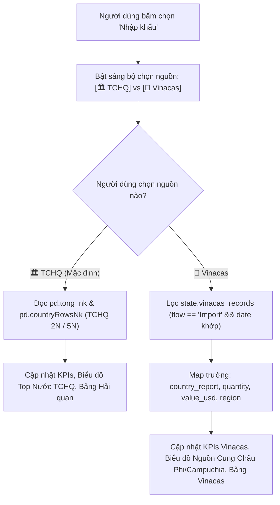

# Kế hoạch Triển Khai: Tùy Chỉnh Nguồn Dữ Liệu TCHQ & Vinacas Cho Luồng Nhập Khẩu Trên Web Dashboard

Tài liệu thiết kế kỹ thuật phục vụ yêu cầu tùy biến nguồn số liệu (**TCHQ** và **Vinacas**) khi người dùng chọn xem luồng **Nhập khẩu** trên giao diện Web Dashboard.

---

## 1. Mô Tả Mục Tiêu (Goal Description)

Hiện tại, hệ thống đã nạp sẵn 757 bản ghi lịch sử từ file [Vincass/Vinacas.xlsx](file:///c:/Users/Acer/Desktop/Dan%20on%20food/XNK/code/Vincass/Vinacas.xlsx) vào cơ sở dữ liệu [all_years_cashew.json](file:///c:/Users/Acer/Desktop/Dan%20on%20food/XNK/code/output/data/all_years_cashew.json) (`vinacas_records`).

Mục tiêu của tính năng này là:
1. Khi người dùng bấm chọn **Nhập khẩu** (hoặc chuyển qua lại giữa các luồng), giao diện xuất hiện **Bộ chuyển đổi Nguồn dữ liệu (Data Source Toggle)** cho phép chọn giữa:
   - 🏛️ **TCHQ (Tổng cục Hải quan)**: Dữ liệu bóc tách từ các báo cáo định kỳ 2N và 5N của Hải quan Việt Nam.
   - 🌾 **Vinacas (Hiệp hội Điều Việt Nam)**: Dữ liệu thị trường nhập khẩu hạt điều thô nguyên liệu do Hiệp hội Vinacas thống kê (Bờ Biển Ngà, Campuchia, Ghana, Nigeria, Tanzania...).
2. Khi chuyển đổi giữa TCHQ và Vinacas:
   - Toàn bộ **KPI Cards** (Lượng tháng, Trị giá USD tháng, Lũy kế YTD) lập tức cập nhật theo nguồn tương ứng.
   - Các **biểu đồ** (Top 10 thị trường cung cấp, Cơ cấu khu vực, Xu hướng lịch sử, Sparkline) vẽ lại theo số liệu của nguồn được chọn.
   - **Bản đồ luồng nhập khẩu (Leaflet map)** và **Bảng dữ liệu chi tiết** chuyển đổi hiển thị nguồn gốc quốc gia tương ứng.
   - Hero banner hiển thị huy hiệu nguồn (Badge: `🏛️ TCHQ` hoặc `🌾 Vinacas`) để người xem luôn biết đang đối chiếu số liệu từ bên nào.

---

## 2. Yêu Cầu Cần Người Dùng Đánh Giá (User Review Required)

> [!IMPORTANT]
> **Về phạm vi hiển thị của bộ chọn nguồn TCHQ / Vinacas:**
> - **Đề xuất khuyến nghị**: Hiển thị bộ chuyển đổi nguồn `[🏛️ TCHQ] [🌾 Vinacas]` khi người dùng bấm vào tab **Nhập khẩu** (vì Vinacas chủ yếu thống kê chi tiết nhập khẩu hạt điều thô từ Châu Phi/Campuchia theo từng đối tác). Khi chọn **Xuất khẩu**, nguồn mặc định là TCHQ (hoặc cho phép chuyển sang Vinacas nếu kỳ đó có số liệu XK Vinacas).
> - **Khi một tháng TCHQ chưa có báo cáo nhưng Vinacas có (hoặc ngược lại)**: Hệ thống sẽ tự động hiển thị thông báo nguồn tương ứng để người dùng đối chiếu chéo rõ ràng.

---

## 3. Kiến Trúc & Luồng Dữ Liệu (Data Architecture)



---

## 4. Đề Xuất Thay Đổi Chi Tiết (Proposed Changes)

### Component 1: Giao Diện Web HTML ([web/index.html](file:///c:/Users/Acer/Desktop/Dan%20on%20food/XNK/code/web/index.html))

#### [MODIFY] `web/index.html`
Thêm nhóm chuyển đổi nguồn dữ liệu ngay cạnh nhóm Luồng thương mại và Phiên bản:

```html
<!-- Ô chuyển đổi Nguồn Dữ Liệu (TCHQ vs Vinacas) -->
<div class="fb-group" id="fb-source-group">
  <span class="fb-label"><span class="lang-vi">Nguồn số liệu</span><span class="lang-en" style="display:none">Data Source</span></span>
  <div class="seg-toggle" id="fb-source" role="group" aria-label="Nguồn dữ liệu">
    <button type="button" data-src="tchq" class="active" onclick="setDataSource('tchq')">
      🏛️ <span class="lang-vi">TCHQ</span><span class="lang-en" style="display:none">Customs</span>
    </button>
    <button type="button" data-src="vinacas" onclick="setDataSource('vinacas')">
      🌾 <span class="lang-vi">Vinacas</span><span class="lang-en" style="display:none">Vinacas</span>
    </button>
  </div>
</div>
```

---

### Component 2: Logic Điều Khiển & Xử Lý Dữ Liệu ([web/app.js](file:///c:/Users/Acer/Desktop/Dan%20on%20food/XNK/code/web/app.js))

#### [MODIFY] `web/app.js`
1. **Bổ sung State**:
   ```javascript
   state.dataSource = 'tchq'; // 'tchq' | 'vinacas'
   state.vinacas_records = []; // Nạp từ all_years_cashew.json
   ```

2. **Hàm Chuyển Đổi Nguồn `setDataSource(src)`**:
   ```javascript
   function setDataSource(src) {
     state.dataSource = src;
     document.querySelectorAll('#fb-source button').forEach(b => {
       b.classList.toggle('active', b.dataset.src === src);
     });
     refreshFilterDependent();
     showToast(state.lang === 'vi' 
       ? `Đã đổi nguồn: ${src === 'tchq' ? 'Tổng cục Hải quan (TCHQ)' : 'Hiệp hội Điều (Vinacas)'}`
       : `Source switched to ${src.toUpperCase()}`, 'info');
   }
   ```

3. **Adapter Trích Xuất Dữ Liệu Vinacas Tương Thích Với Pipeline**:
   Xây dựng hàm chuyển đổi danh sách `vinacas_records` của kỳ hiện tại thành định dạng `countryRows` chuẩn để tái sử dụng toàn bộ biểu đồ, bản đồ và bảng:
   ```javascript
   function getVinacasRows(period) {
     if (!state.vinacas_records || !state.vinacas_records.length) return [];
     const flowFilter = (state.flow === 'export') ? 'export' : 'import';
     const targetMonth = period; // YYYY-MM
     const targetYear = period ? period.slice(0, 4) : '';

     return state.vinacas_records
       .filter(r => (r.flow || '').toLowerCase() === flowFilter && (r.fulldate || '').startsWith(targetMonth))
       .map(r => ({
         country: r.country_report || r.country_raw,
         product: r.product || 'Raw Cashew Nut',
         unit: r.unit || 'Tấn',
         quantity_month: Number(r.quantity) || 0,
         value_month_usd: Number(r.value_usd) || 0,
         cy_luong: Number(r.quantity) || 0,
         cy_tri_gia: Number(r.value_usd) || 0,
         region: (r.region || '').toLowerCase(),
         source: 'Vinacas'
       }));
   }
   ```

4. **Đồng Bộ Vào `getFilteredRowsBase(period)` & `periodTotals(p)`**:
   - Khi `state.flow === 'import' && state.dataSource === 'vinacas'`:
     `getFilteredRowsBase` trả về danh sách các nước từ Vinacas.
     `periodTotals` tính tổng lượng và tổng trị giá USD từ Vinacas.
   - Khi `state.dataSource === 'tchq'`: Giữ nguyên luồng TCHQ chuẩn mực hiện tại.

5. **Cập Nhật `updateHero()` & Badge Nguồn**:
   - Hiển thị badge nguồn tương ứng: `🏛️ Nguồn: Tổng cục Hải quan` hoặc `🌾 Nguồn: Hiệp hội Vinacas`.

---

## 5. Kế Hoạch Kiểm Thử (Verification Plan)

### Kiểm Thử Tự Động / Build
1. Kiểm tra cú pháp Javascript và HTML:
   - Đảm bảo không có lỗi tham chiếu DOM hoặc console error.
2. Kiểm tra nạp file JSON:
   - Đảm bảo `all_years_cashew.json` nạp đủ 757 bản ghi Vinacas vào `state.vinacas_records`.

### Kiểm Thử Trực Quan (Browser Subagent)
1. Truy cập Web Dashboard `http://127.0.0.1:8089/web/`.
2. Bấm chọn luồng **Nhập khẩu**.
3. Bấm chuyển đổi qua lại giữa **🏛️ TCHQ** và **🌾 Vinacas**.
4. Xác nhận:
   - Khi chọn **TCHQ**: Hiển thị số liệu Hải quan (Lượng, USD, danh sách nước TCHQ).
   - Khi chọn **Vinacas**: Hiển thị số liệu nguyên liệu thô từ Vinacas (Bờ Biển Ngà, Campuchia, Ghana, Nigeria...), biểu đồ phân bổ cập nhật tức thì.
   - Chuyển đổi giữa các năm (2020..2026) qua Dropdown năm hoạt động mượt mà với cả 2 nguồn.
