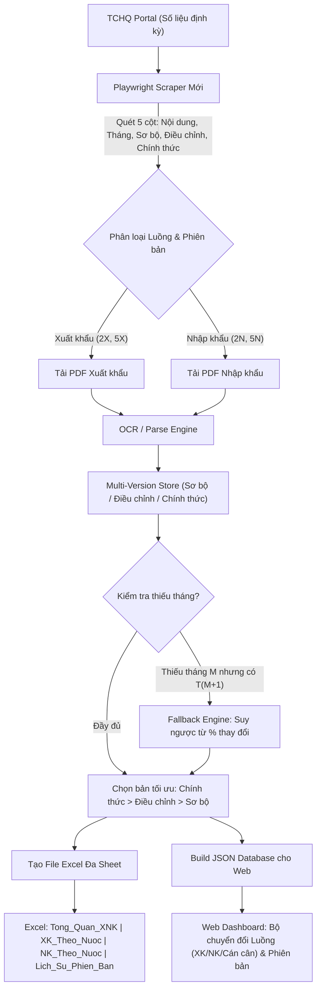

# 📋 KẾ HOẠCH PHÂN LẠI LUỒNG DỮ LIỆU TCHQ & BỔ SUNG TÍNH NĂNG (MASTER PLAN)

> **Mục tiêu:** Nâng cấp hệ thống thu thập & phân tích dữ liệu XNK Hạt điều từ Tổng cục Hải quan (TCHQ) sang kiến trúc đa phiên bản, đa chiều (Xuất khẩu & Nhập khẩu), bổ sung cơ chế suy ngược (fallback) khi thiếu số liệu tháng, tái cấu trúc Excel chuẩn và bổ sung các ô chuyển đổi trên Web Dashboard.

---

## 1. TỔNG QUAN KIẾN TRÚC MỚI (HIGH-LEVEL ARCHITECTURE)

---

## 2. CHI TIẾT CÁC GIAI ĐOẠN TRIỂN KHAI

### GIAI ĐOẠN 1: Tái cấu trúc Scraper thu thập dữ liệu TCHQ (`pipeline/scraper.py`)

1. **Nhận diện đầy đủ 5 cột trên bảng TCHQ:**
   - Cột 0: `Nội dung` (Tên báo cáo)
   - Cột 1: `Tháng` (Định dạng MM-YYYY)
   - Cột 2: `Sơ bộ` (Link PDF bản Sơ bộ)
   - Cột 3: `Điều chỉnh` (Link PDF bản Điều chỉnh)
   - Cột 4: `Chính thức` (Link PDF bản Chính thức)

2. **Mở rộng nhận diện 4 nhóm báo cáo cốt lõi:**
   - `export_summary` (Biểu 2X): `"Xuất khẩu hàng hóa tháng MM/YYYY"`
   - `export_country` (Biểu 5X): `"Xuất khẩu hàng hóa sang một số nước/vùng lãnh thổ chia theo mặt hàng chủ yếu tháng MM/YYYY"`
   - `import_summary` (Biểu 2N): `"Nhập khẩu hàng hóa tháng MM/YYYY"`
   - `import_country` (Biểu 5N): `"Nhập khẩu hàng hóa từ một số nước/vùng lãnh thổ chia theo mặt hàng chủ yếu tháng MM/YYYY"`

3. **Cơ chế lưu trữ File PDF phân loại theo phiên bản:**
   - Cấu trúc thư mục:
     `output/YYYY/YYYY-MM/pdfs/{direction}_{report_type}_{version}.pdf`
     (Ví dụ: `export_summary_preliminary.pdf`, `export_summary_official.pdf`, `import_summary_preliminary.pdf`).
   - Gắn metadata đầy đủ: `flow` (export/import), `period` (YYYY-MM), `version` (preliminary/adjusted/official), `source_url`, `sha256`.

---

### GIAI ĐOẠN 2: Nâng cấp Bộ bóc tách & Lọc dữ liệu (`pipeline/ocr_pipeline.py`)

1. **Bộ phân loại Báo cáo:**
   - Tách biệt luồng nhận diện Xuất khẩu (`direction = "export"`) và Nhập khẩu (`direction = "import"`).
   - Khớp từ khóa mặt hàng Hạt điều: `"Hạt điều"`, `"hat dieu"`, `"Điều thô"`, `"Hat dieu chua boc vo"`.

2. **Trích xuất thông số chi tiết (kể cả % thay đổi):**
   - Trích xuất:
     - `quantity_month` (Lượng trong tháng)
     - `value_month_usd` (Trị giá tháng USD)
     - `pct_change_prev_month_qty` (% so với tháng trước về Lượng)
     - `pct_change_prev_month_val` (% so với tháng trước về Trị giá)
     - `quantity_ytd` (Cộng dồn Lượng)
     - `value_ytd_usd` (Cộng dồn Trị giá)
     - `pct_change_yoy_qty` (% so cùng kỳ về Lượng)
     - `pct_change_yoy_val` (% so cùng kỳ về Trị giá)

3. **Thuật toán Fallback suy ngược số liệu (Extrapolation / Backfill):**
   - **Điều kiện kích hoạt:** Khi phát hiện tháng $M$ bị khuyết số liệu tháng (không có báo cáo $M$, hoặc báo cáo $M$ thiếu mặt hàng hạt điều), nhưng tháng $M+1$ có số liệu:
   - **Công thức tính:**
     $$Q_M = \frac{Q_{M+1}}{1 + \frac{\% \Delta Q_{M+1}}{100}}$$
     $$V_M = \frac{V_{M+1}}{1 + \frac{\% \Delta V_{M+1}}{100}}$$
   - **Kiểm chứng chéo YTD (nếu có):**
     $$Q_{M,\text{check}} = Q_{YTD, M+1} - Q_{YTD, M-1} \quad \text{hoặc} \quad Q_{YTD, M+1} - Q_{M+1}$$
   - **Đánh dấu bản ghi:**
     - `is_derived = True`
     - `source_note = "Ước tính suy ngược từ T(M+1) theo % thay đổi TCHQ"`
     - `derived_confidence = 0.95`

---

### GIAI ĐOẠN 3: Tái cấu trúc File Excel Đầu ra (`output/all_years_cashew.xlsx`)

Định dạng 4 Sheet chuyên nghiệp chuẩn báo cáo Dan On Food:

| Tên Sheet | Nội dung chính | Điểm nổi bật |
|:---|:---|:---|
| **`Tong_Quan_XNK`** | Tổng hợp theo tháng: Xuất khẩu, Nhập khẩu, Cán cân XNK (Net Value) | - Có cột `Phiên bản` (Chính thức/Điều chỉnh/Sơ bộ/Ước tính). - Ô suy ngược fallback được **highlight màu vàng nhạt** (`#FFF3CD`) kèm comment ghi chú nguồn. |
| **`XK_Theo_Nuoc`** | Số liệu chi tiết xuất khẩu theo từng quốc gia | Dòng `Other` chuẩn xác (Tổng trừ các nước công bố). |
| **`NK_Theo_Nuoc`** | Số liệu chi tiết nhập khẩu theo từng quốc gia | Đầy đủ các thị trường cung ứng điều thô chính (Bờ Biển Ngà, Campuchia, Ghana, v.v.). |
| **`Lich_Su_Phien_Ban`** | Bảng so sánh song song đối chiếu các phiên bản của từng kỳ | Cho phép thấy rõ độ chênh lệch giữa Sơ bộ ↔ Điều chỉnh ↔ Chính thức. |

---

### GIAI ĐOẠN 4: Nâng cấp Web Dashboard (`web/`) & Các ô chuyển đổi

1. **Bộ chuyển đổi Luồng dữ liệu (Trade Flow Switcher):**
   - Thêm nút chuyển đổi trực quan trên thanh Topbar/Filter-bar:
     - 📤 **Xuất khẩu (Export)**: Xem thị trường xuất khẩu, sản lượng, kim ngạch bán ra.
     - 📥 **Nhập khẩu (Import)**: Xem nguồn cung ứng nguyên liệu điều thô về Việt Nam.
     - ⚖️ **Cán cân thương mại (Trade Balance)**: So sánh Xuất vs Nhập, đồ thị Net Export & Tỷ lệ nhập khẩu nguyên liệu / xuất khẩu thành phẩm.

2. **Bộ chuyển đổi Phiên bản dữ liệu (Data Version Selector):**
   - Dropdown hoặc Segmented Toggle:
     - 🏆 **Hợp nhất tối ưu (Khuyến nghị)**: Tự động dùng phiên bản cao nhất có được (`Chính thức` > `Điều chỉnh` > `Sơ bộ`).
     - 📑 **Chính thức (Official)**: Chỉ xem số liệu đã được chốt chính thức.
     - ✏️ **Điều chỉnh (Adjusted)**: Xem các số liệu có đợt điều chỉnh.
     - ⏱️ **Sơ bộ (Preliminary)**: Xem số liệu sơ bộ ban đầu công bố.

3. **Hiển thị Badge cảnh báo cho số liệu Fallback (Derived Data Indicator):**
   - Các điểm dữ liệu được suy ngược từ tháng sau sẽ có badge biểu tượng `⚡ Ước tính` kèm tooltip giải thích công thức tính.

---

## 3. LỘ TRÌNH THỰC HIỆN CỤ THỂ

1. **Bước 1:** Cập nhật `pipeline/scraper.py` — hỗ trợ cào cả 3 cột (Sơ bộ, Điều chỉnh, Chính thức) và 2 luồng (Xuất khẩu 2X/5X, Nhập khẩu 2N/5N).
2. **Bước 2:** Cập nhật `pipeline/ocr_pipeline.py` — parser cho cả Xuất khẩu & Nhập khẩu, bổ sung module `FallbackEstimator` tính suy ngược từ % thay đổi.
3. **Bước 3:** Cập nhật `pipeline/data_builder.py` — tạo file Excel 4 sheet chuẩn (với format màu highlight fallback) và build JSON đa chiều (`export`, `import`, `versions`).
4. **Bước 4:** Nâng cấp giao diện `web/index.html`, `web/style.css`, `web/app.js` — bổ sung 2 ô chuyển đổi (Flow Toggle & Version Selector), render số liệu xuất/nhập khẩu và cán cân.
5. **Bước 5:** Chạy thử nghiệm trọn vẹn (End-to-End Test), xuất file Excel và kiểm tra tính nhất quán.
