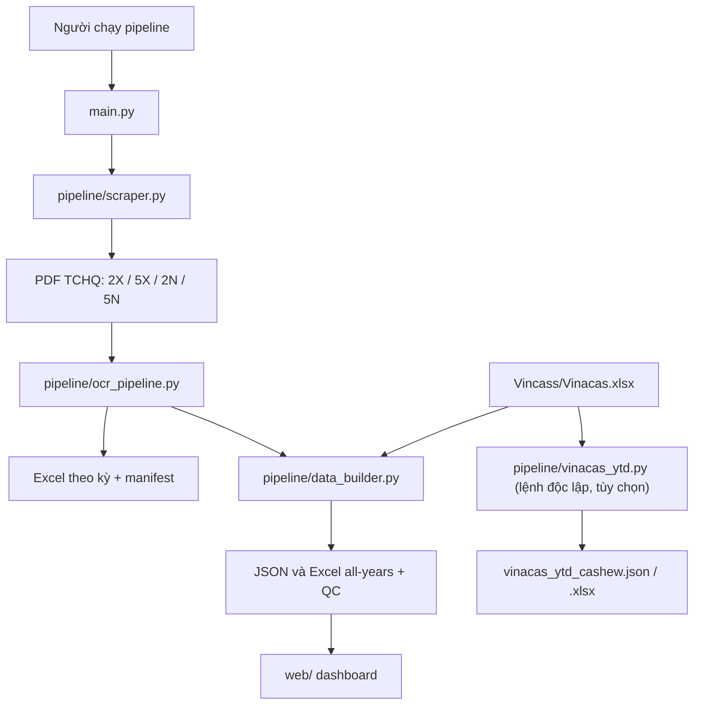

# README 01 — Tổng quan workflow XNK Cashew

Tài liệu này giải thích **các luồng dữ liệu và thứ tự chạy của hệ thống**, không đi qua từng câu lệnh Python. Walkthrough theo source nằm ở [README_02_ORCHESTRATOR.md](README_02_ORCHESTRATOR.md), [README_03_INGESTION_OCR.md](README_03_INGESTION_OCR.md) và [README_04_AGGREGATION.md](README_04_AGGREGATION.md).

> Đường dẫn và line range trong bộ tài liệu được đối chiếu với code hiện tại. Sau khi đổi code, hãy kiểm tra lại các link `#L...` trong hướng dẫn tương ứng.

## 1. Sơ đồ tổng thể



### Mỗi module phụ trách việc gì?

| Thành phần | Vai trò | Điểm bắt đầu trong source |
|---|---|---|
| [`main.py`](../main.py#L1-L14) | CLI điều phối: chọn kỳ/năm, cache, scrape, OCR và rebuild dữ liệu tổng hợp. | [`main()`](../main.py#L377-L427) |
| [`pipeline/paths.py`](../pipeline/paths.py#L1-L41) | Chuẩn hóa output root và đường dẫn kỳ/luồng. | `resolve_output_root()` |
| [`pipeline/scraper.py`](../pipeline/scraper.py#L1-L22) | Cào danh sách báo cáo TCHQ bằng Playwright, tải PDF và xác thực file. Có thêm CLI online/local riêng. | `fetch_tchq_playwright()` / `fetch_tchq_multi_period()` |
| [`pipeline/ocr_pipeline.py`](../pipeline/ocr_pipeline.py#L1-L58) | Nhận diện PDF, trích bảng/text, parse summary/quốc gia, backfill, ghi Excel và manifest. | `run_period()` |
| [`pipeline/data_builder.py`](../pipeline/data_builder.py#L1-L50) | Đọc workbook theo kỳ, hợp nhất schema, backfill tùy chọn, sinh JSON/workbook all-years và QC. | `build_all_years()` |
| [`pipeline/vinacas_ytd.py`](../pipeline/vinacas_ytd.py#L1-L64) | CLI độc lập tính YTD cho dữ liệu Vinacas; chỉ ghi ngược vào JSON khi truyền cờ rõ ràng. | `main()` |
| [`pipeline/serve_dashboard.py`](../pipeline/serve_dashboard.py#L1-L74) | Helper HTTP nhỏ để phục vụ web và map URL dữ liệu. Không nằm trong đường xử lý ETL của `main.py`. | `main()` |

`pipeline/serve_dashboard.py` hiện đặt `ROOT` bằng thư mục chứa file (thư mục `pipeline/`), rồi suy ra `WEB_DIR` và `OUTPUT_DIR` từ đó. Trong cây dự án, `web/` và `output/` nằm ở thư mục cha, nên cần lưu ý đường dẫn này khi vận hành server. Tài liệu này không thay đổi hay sửa code server.

## 2. Workflow chính: một kỳ TCHQ

Ví dụ:

```powershell
python main.py --period 2026-09
```

Trình tự:

1. `main()` phân tích CLI, resolve `--output-root` rồi gọi `run()`.
2. `run()` kiểm tra Smart Cache trừ khi dùng `--force`, `--clean` hoặc `--fixture`.
3. Nếu không ở fixture mode, `scraper.fetch_tchq_playwright()` mở trang công bố TCHQ, nhận diện báo cáo XK/NK và từng phiên bản. Với mỗi PDF, scraper kiểm tra chữ ký `%PDF`, kích thước và SHA-256.
4. `main._copy_pdfs()` đặt PDF vào đúng thư mục luồng; OCR chỉ chạy trên artifact hợp lệ.
5. `ocr_pipeline.run_period()` phân loại từng PDF, trích dòng, chọn summary và phân rã quốc gia; khi cần có thể backfill summary thiếu.
6. OCR ghi workbook tháng, bản sao PDF theo luồng và manifest. Khi được gọi với `update_data=True`, OCR tiếp tục gọi `data_builder.update_period_data()`.
7. `run()` trả mã thoát thành công nếu có artifact hợp lệ và OCR có dữ liệu summary hoặc pivot; nếu không, trả mã lỗi.

## 3. Workflow nhiều năm

```powershell
python main.py --from-year 2020 --to-year 2026
# hoặc
python main.py --years 2020,2022-2025
```

- `run_years()` tạo danh sách 12 kỳ cho mỗi năm.
- Mặc định scraper quét danh sách TCHQ một lượt cho toàn range, gom artifact theo kỳ rồi OCR từng kỳ.
- `--reuse-pdfs` bỏ bước scrape và lấy PDF hợp lệ đã có trong `Xuat_Khau/` / `Nhap_Khau/`.
- OCR trong vòng lặp được gọi với `update_data=False`, tránh rebuild all-years lặp lại theo từng kỳ.
- Sau vòng lặp, `data_builder.build_all_years(backfill=True)`, `build_qc_report()` và `validate_aggregate_outputs()` được gọi một lượt.
- Cache có thể bỏ qua từng kỳ độc lập. `--force` buộc chạy lại; `--clean` dọn file PDF FDI theo logic trong `main.py` trước khi chạy.

## 4. Fallback: dữ liệu suy tính, không phải PDF mới

Hai module có các đường backfill riêng:

- `ocr_pipeline.attempt_backfill_summary()` ưu tiên YTD Difference; nếu không đủ điều kiện thì thử YoY Proxy từ cùng tháng năm trước.
- `data_builder.apply_auto_backfill()` thực hiện fallback trong giai đoạn tổng hợp all-years. Nó cũng đảm bảo có dòng `Other` để phần chênh tổng summary với các dòng quốc gia được nhìn thấy.

Giá trị fallback có metadata như `is_derived`, `debug_source_type` và `debug_source_note`; ghi chú nguồn cho biết cách tính hoặc kỳ proxy. Đừng diễn giải dòng `Other` tính bằng phép trừ là một kỳ backfill: `calculated` và `ytd_diff`/`yoy_proxy` là các loại nguồn khác nhau.

Chỉ chạy rebuild/backfill, không scrape hay OCR:

```powershell
python main.py --backfill
```

Lệnh này build all-years với backfill, rồi tạo báo cáo đối soát. Nó không có nghĩa là tải lại PDF.

## 5. Vinacas là chuỗi riêng

Trong `data_builder.build_all_years()`, file `Vincass/Vinacas.xlsx` được đọc và chuẩn hóa thành `vinacas_records` và các bản ghi Vinacas trong JSON/workbook tổng hợp. Chỗ này **không tự tính YTD** bằng script riêng.

`pipeline/vinacas_ytd.py` là workflow độc lập:

```powershell
python pipeline/vinacas_ytd.py --source auto
```

`auto` thử JSON all-years trước, rồi mới thử workbook Vinacas. Script tạo `vinacas_ytd_cashew.json` và `vinacas_ytd_cashew.xlsx`; các năm có một kỳ duy nhất được xem như báo cáo annual để tránh cộng dồn lại. Ghi ngược YTD vào `all_years_cashew.json` chỉ khi truyền `--update-all-years`; trước khi ghi, script tạo file `.json.bak`.

Không cộng TCHQ imports và Vinacas RCN imports thành một tổng: nguồn và phạm vi thống kê khác nhau.

## 6. Các artifact sau từng tầng

| Tầng | Artifact điển hình | Dùng để |
|---|---|---|
| Scrape | PDF trong `output/YYYY/YYYY-MM/Xuat_Khau/` và `Nhap_Khau/` | Đầu vào OCR, có thể tái sử dụng bằng `--reuse-pdfs`. |
| OCR | `YYYY-MM_cashew.xlsx`, `YYYY-MM_manifest.json` | Kết quả theo kỳ và metadata/trạng thái parse. Workbook tách summary, balance, country theo phiên bản, history, Vinacas và `_Meta`. |
| Tổng hợp | `output/data/YYYY_cashew.json`, `output/data/all_years_cashew.json`, `output/all_years_cashew.xlsx` | Nạp dashboard, so sánh giữa năm và export dữ liệu tổng hợp. |
| QC | `output/qc/*_qc.csv/json`, `output/qc/aggregate_reconciliation.json` | Xem trạng thái theo kỳ và đối chiếu record workbook/JSON. |
| Vinacas YTD standalone | `output/vinacas_ytd_cashew.json/.xlsx` | CY/YTD theo quốc gia và tổng kỳ, không thay thế dữ liệu nguồn. |

## 7. Chạy riêng từng tầng để điều tra lỗi

```powershell
# Chỉ scrape
python pipeline/scraper.py --source tchq --period 2026-09 --mode auto

# Chỉ OCR từ PDF đã có
python pipeline/ocr_pipeline.py --period 2026-09 --output-root output

# Chỉ rebuild dữ liệu tổng hợp
python pipeline/data_builder.py --all-years

# Tính YTD cho Vinacas độc lập
python pipeline/vinacas_ytd.py --source auto
```

Standalone scraper là đường chạy đơn giản hơn (online/local), không thay thế luồng Playwright nhiều kỳ trong `main.py`. Khi so sánh kết quả, hãy kiểm tra đúng `period`, direction, version, file nguồn và trạng thái `derived`.

## 8. Bắt đầu đọc code

- Muốn biết CLI, cache, điều phối: [README_02_ORCHESTRATOR.md](README_02_ORCHESTRATOR.md).
- Muốn hiểu scraper và cách parse PDF/OCR: [README_03_INGESTION_OCR.md](README_03_INGESTION_OCR.md).
- Muốn hiểu workbook → JSON/all-years, QC và YTD Vinacas: [README_04_AGGREGATION.md](README_04_AGGREGATION.md).
- Danh sách kiểm tra và lệnh vận hành ở trang gốc: [`README.md`](../README.md).
