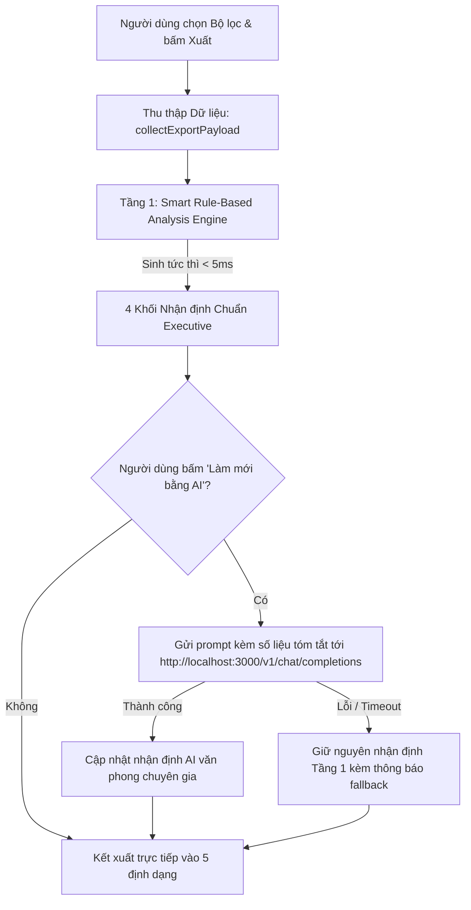

# MASTER PLAN: CHUẨN HÓA LAYOUT XUẤT DỮ LIỆU & TÍCH HỢP AI ANALYSIS (DAN ON FOODS)

---

## 1. TỔNG QUAN & ĐÁNH GIÁ HIỆN TRẠNG 5 ĐỊNH DẠNG XUẤT

Hiện tại hệ thống `web/app.js` đã hỗ trợ 5 định dạng xuất: **HTML**, **Excel (XLSX)**, **PDF**, **PowerPoint (PPTX)**, và **JSON/CSV**.

### Đánh giá hiện trạng layout:
| Định dạng | Trạng thái kỹ thuật | Đánh giá Layout & Visual | Khoảng trống cần khắc phục |
| :--- | :--- | :--- | :--- |
| **HTML Report** | Hoạt động, có chế độ trình chiếu `?slides=1` | Khá tốt, responsive, có biểu đồ Highcharts | Thiếu khối **Nhận định thị trường (Executive Summary)**; chưa có nút trigger làm mới phân tích bằng AI. |
| **Excel (XLSX)** | Hoạt động (ExcelJS 5 sheets), có chart nhúng | Chuẩn màu thương hiệu, dữ liệu sạch | Sheet `Tong_Quan` mới chỉ có số thô, thiếu khối bình luận phân tích điều hành cho ban lãnh đạo. |
| **PDF (A4 Landscape)** | Hoạt động (jsPDF + autoTable), font Be Vietnam Pro | Bố cục trang bìa & chart tốt | Trang 2 mới chỉ có thẻ KPI nhỏ, trang bị trống trải, thiếu phần nhận định chiều sâu trước khi vào bảng chi tiết. |
| **PowerPoint (PPTX)** | Hoạt động (PptxGenJS, Widescreen 16:9), native chart | Đẹp, biểu đồ vector native chỉnh sửa được | Nhảy trực tiếp từ KPI sang biểu đồ Top 10, thiếu Slide **"Key Takeaways & Market Insights"**. |
| **JSON & CSV** | Hoạt động, schema v1 | Đủ số liệu kỹ thuật | JSON chưa đính kèm cấu trúc metadata phân tích ngữ nghĩa (`ai_analysis`). |

---

## 2. KIẾN TRÚC PHÂN TÍCH THỊ TRƯỜNG HYBRID (AI ANALYSIS ENGINE)

Để đảm bảo **xuất báo cáo luôn tức thì (zero delay), 100% không lỗi khi mất mạng**, đồng thời **vẫn có thể làm giàu nhận định sâu sắc bằng AI**, kiến trúc được thiết kế theo mô hình **Hybrid 2 tầng**:



### Cấu trúc 4 khối nhận định chuẩn Executive:
1. **Tóm tắt điều hành (Executive Summary):** Tổng kim ngạch (USD), sản lượng (Tấn), đơn giá bình quân (USD/tấn), tốc độ tăng trưởng so với cùng kỳ (YoY) và tháng trước (MoM).
2. **Động lực thị trường & Biến động nổi bật (Market Drivers):** Nhận diện top 3 thị trường bứt phá mạnh nhất (tăng trưởng lượng & giá trị), các thị trường suy giảm đột biến và cảnh báo tỷ trọng phụ thuộc.
3. **Cảnh báo giá & Biên độ (Price & Margin Alerts):** Biến động đơn giá bình quân xuất khẩu/nhập khẩu, so sánh biên độ giá giữa các thị trường xuất khẩu chủ lực (Mỹ, Trung Quốc, EU).
4. **Khuyến nghị & Triển vọng mùa vụ (Outlook & Actionable Insights):** Nhận định theo chu kỳ mùa vụ ngành điều, đề xuất kế hoạch thu mua nguyên liệu hoặc thúc đẩy bán hàng.

---

## 3. THIẾT KẾ CHI TIẾT LAYOUT CHO TỪNG ĐỊNH DẠNG

### 3.1. Báo cáo HTML (HTML Report & Slide View)
- **Vị trí khối AI:** Đặt ngay dưới hàng Thẻ KPI tổng quan và trên Biểu đồ phân tích.
- **Visual:** Card nền kem mờ cao cấp (`rgba(245, 235, 208, 0.08)`), viền vàng Dan On (`#C9A227`), huy hiệu "AI Market Insights" màu vàng gold.
- **Tương tác:** Nút icon `✨ Phân tích lại bằng AI (Local LLM)` cho phép kích hoạt gọi endpoint `http://localhost:3000/v1/chat/completions` sinh lại nhận định trực tiếp trên trang mà không cần reload.
- **Chế độ trình chiếu (`?slides=1`):** Tách thành 1 slide riêng mang tên "Slide 2: Nhận định điều hành & Động lực thị trường" với các bullet point lớn, dễ đọc từ khoảng cách xa.

### 3.2. Báo cáo PDF (A4 Landscape - Chuyên nghiệp & Sẵn sàng in ấn)
- **Trang 1:** Trang bìa sang trọng (Brand header, Tiêu đề thời kỳ báo cáo, Nguồn dữ liệu TCHQ/Vinacas, Người lập, Ngày xuất, Tem Dan On Foods).
- **Trang 2 (Trang mới): Executive Briefing:**
  - Nửa trên: 4 thẻ KPI đóng khung viền vàng (Tổng kim ngạch, Sản lượng, Đơn giá trung bình, Tăng trưởng YoY).
  - Nửa dưới: Khối 4 nhận định AI được dàn thành 2 cột cân đối, sử dụng font tiếng Việt `Be Vietnam Pro` sắc nét, khoảng cách dòng thoáng, không bị tràn sang trang 3.
- **Trang 3: Visual Analytics:**
  - Biểu đồ Top 10 thị trường lớn nhất (Bar Chart).
  - Biểu đồ Xu hướng biến động 12 tháng gần nhất (Line/Area Chart).
- **Trang 4+: Bảng số liệu chi tiết:** Bảng phân trang tự động bằng `jspdf-autotable`, cố định tiêu đề cột ở mỗi trang, đánh số trang dạng `Trang X / Y`.

### 3.3. Báo cáo PowerPoint (PPTX - Widescreen 16:9)
- **Slide 1:** Cover Slide (Chủ đề màu xanh đen `#17231F`, chữ vàng `#C9A227`, subtitle thời kỳ).
- **Slide 2:** Tổng quan KPIs (4 shape cards bo góc chứa các chỉ số vĩ mô và % tăng trưởng).
- **Slide 3 (Slide mới): Key Takeaways & Market Insights:**
  - 4 khối hộp chữ nhật nền kem viền vàng đại diện cho 4 chủ đề nhận định.
  - Mỗi khối chứa tiêu đề in hoa + các gạch đầu dòng súc tích, chuyên nghiệp cho cuộc họp ban điều hành.
- **Slide 4:** Biểu đồ Top 10 thị trường (Native bar chart có thể click chỉnh sửa số liệu trong PowerPoint) + Khung ghi chú nhận định bên phải.
- **Slide 5:** Biểu đồ Xu hướng & Cơ cấu thị phần (Native Line chart + Doughnut chart).
- **Slide 6+:** Bảng số liệu chi tiết quốc gia với định dạng bảng PPTX chuẩn.

### 3.4. Báo cáo Excel (XLSX - Kế toán & Phân tích chuyên sâu)
- **Sheet `Tong_Quan`:**
  - Dòng 1–4: Banner thương hiệu Dan On Foods Trade Explorer.
  - Dòng 6–14: Khối **"Bình Luận Điều Hành & Phân Tích Xu Hướng"** (Merged cells, nền nhạt `#FBF8F0`, viền đôi vàng `#C9A227`, font chữ in hoa tiêu đề và đoạn văn nhận định rõ ràng).
  - Dòng 16+: Bảng tổng hợp số liệu theo luồng (Xuất khẩu, Nhập khẩu, Cán cân) và so sánh cùng kỳ.
- **Sheet `Bieu_Do`:** Nhúng ảnh biểu đồ Highcharts độ phân giải cao kèm bảng số liệu tóm tắt bên cạnh.
- **Sheet `XK_Theo_Nuoc` & `NK_Theo_Nuoc`:** Định dạng chuẩn tài chính: Cột số canh phải với định dạng `#,##0.00`, tiêu đề cột xanh đậm chữ trắng, bật AutoFilter.
- **Sheet `_Meta`:** Bảng kiểm tra toàn vẹn dữ liệu (Checksum, Timestamp, Source filter, Model AI).

### 3.5. JSON & CSV (Tích hợp hệ thống & Truy xuất dữ liệu thô)
- **JSON:** Bổ sung trường `ai_analysis`:
  ```json
  "ai_analysis": {
    "engine": "hybrid-smart-v1",
    "generated_at": "2026-10-26T16:35:00Z",
    "executive_summary": "...",
    "market_drivers": ["..."],
    "price_alerts": "...",
    "recommendations": ["..."]
  }
  ```
- **CSV:** Giữ định dạng UTF-8 BOM tiêu chuẩn, tương thích hoàn toàn khi mở trực tiếp bằng Excel tiếng Việt.

---

## 4. KẾ HOẠCH TRIỂN KHAI THEO CÁC GIAI ĐOẠN

```mermaid
gantt
    title Tiến độ triển khai Chuẩn hóa Layout & AI Analysis
    dateFormat  YYYY-MM-DD
    section Tầng Core AI
    Xây dựng Smart Rule-Based Engine trong app.js       :done, a1, 2026-10-26, 1d
    Tích hợp Client gọi Local LLM API (localhost:3000)  :active, a2, 2026-10-26, 1d
    section Chuẩn hóa 5 Layouts
    Cập nhật HTML Report & Slide View Mode             :b1, 2026-10-26, 1d
    Cập nhật PDF Export (Trang Executive Briefing)     :b2, 2026-10-26, 1d
    Cập nhật PPTX Export (Slide Takeaways & Insights)  :b3, 2026-10-26, 1d
    Cập nhật Excel Export (Khối Nhận định Tổng Quan)   :b4, 2026-10-26, 1d
    Cập nhật JSON Schema (Trường ai_analysis)          :b5, 2026-10-26, 1d
    section Kiểm thử & Nghiệm thu
    Chạy bộ kiểm thử tự động Playwright (ui_verify.py) :c1, 2026-10-26, 1d
```

### Các bước thực hiện:
1. **Bước 1:** Viết module `generateMarketNarrative(payload)` trong `web/app.js`: Phân tích biến động tăng giảm, tìm thị trường đột biến, tính đơn giá trung bình và sinh 4 khối nội dung.
2. **Bước 2:** Viết hàm gọi API Local LLM `fetchLLMInsights(payload)` trỏ tới `http://localhost:3000/v1/chat/completions`, với prompt chuyên sâu phân tích ngành điều Việt Nam.
3. **Bước 3:** Cập nhật hàm `buildReportHTML()` chèn Card Phân tích AI và nút tương tác.
4. **Bước 4:** Cập nhật hàm `exportPDF()` bổ sung Trang 2 Executive Briefing với bảng thẻ nhận định 2 cột.
5. **Bước 5:** Cập nhật hàm `exportPPTX()` chèn Slide 3 "Executive Insights" với định dạng hộp thẻ cao cấp.
6. **Bước 6:** Cập nhật hàm `exportExcel()` ghi khối nhận định phân tích vào đầu sheet `Tong_Quan`.
7. **Bước 7:** Mở rộng kịch bản kiểm thử `ui_verify.py` để tự động kiểm tra cả 5 định dạng xuất ra có đầy đủ nội dung nhận định và layout hợp lệ.

---

## 5. TIÊU CHÍ NGHIỆM THU (ACCEPTANCE CRITERIA)

- [ ] **Tính sẵn sàng:** Bấm xuất bất kỳ định dạng nào cũng có sẵn phân tích tức thì, không bị treo hoặc rỗng nội dung nếu local LLM chưa bật.
- [ ] **Tính chính xác số liệu:** Mọi số liệu trong phần nhận định (tổng giá trị, % tăng giảm, đơn giá) khớp 100% với bảng biểu và thẻ KPI.
- [ ] **Thẩm mỹ & Brand Identity:** Giữ trọn vẹn bộ nhận diện Dan On Foods (Màu vàng kim `#C9A227`, Xanh sẫm `#17231F`, Kem `#F5EBD0`), font chữ tiếng Việt không bị lỗi dấu.
- [ ] **Layout không lỗi tràn trang:** PDF trang 2 và PPTX slide 3 căn lề chuẩn mực, co giãn linh hoạt theo độ dài đoạn văn bản.
- [ ] **Kiểm thử tự động:** Script `python ui_verify.py` chạy thành công 100% với exit code 0.
