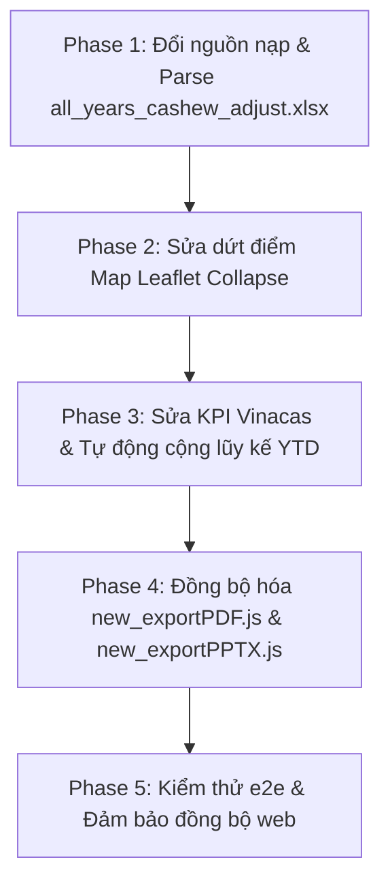

# MASTER PLAN: SỬA LỖI DASHBOARD, CHUẨN HÓA VINACAS VÀ ĐỒNG BỘ XUẤT BÁO CÁO (PDF/PPTX)

## 1. Mục tiêu và Bối cảnh
- **File dữ liệu chính:** `output/all_years_cashew_adjust.xlsx` (có đủ 7 sheets: `Tong_Quan_XNK_All`, `Can_Can_Thuong_Mai_All`, `XK_Theo_Nuoc_All`, `NK_Theo_Nuoc_All`, `Lich_Su_Phien_Ban_All`, `Vinacas`, `Tong_XK_All`).
- **Các vấn đề tồn đọng:**
  1. Web chưa ưu tiên load file `all_years_cashew_adjust.xlsx` (vẫn đang load `all_years_cashew.xlsx`).
  2. Tab **Bản đồ (Map)** bị collapse hoặc méo layout do Leaflet không được recalculate kích thước (`invalidateSize()`) đúng thời điểm khi chuyển tab hoặc thay đổi view.
  3. **KPIs của Vinacas không hiển thị:** Dữ liệu sheet Vinacas có 757 dòng nhưng khi chuyển nguồn dữ liệu sang Vinacas thì các thẻ KPI và card tổng quan không phản ánh đúng do logic lọc/tính tổng (thiếu dòng tổng hợp, lệch flow import/export hoặc bị chặn bởi version check).
  4. **YTD của Vinacas:** Cần cơ chế tự động lũy kế cộng dồn (accumulated) chính xác qua từng tháng trong năm (đối với các năm nhiều tháng như 2023-2026), giữ nguyên số liệu năm đối với các năm 2018-2022 (chỉ có kỳ -12).
  5. **Bộ đôi xuất báo cáo (`new_exportPDF.js` & `new_exportPPTX.js`):** Hiện tại chưa hỗ trợ phân nhánh dữ liệu khi đang ở nguồn Vinacas (mặc định bám vào TCHQ), cần nâng cấp đồng bộ để xuất PDF/PPTX chuẩn chuyên nghiệp cho cả 2 nguồn.

---

## 2. Kế hoạch triển khai chi tiết từng Phase

### Phase 1: Cấu hình nạp dữ liệu chính `all_years_cashew_adjust.xlsx`
- **File cần sửa:** `web/app.js` (hàm `loadAllYearsExcel` và endpoint kiểm tra).
- **Chi tiết:**
  - Cập nhật thứ tự nạp: Thử fetch `/output/all_years_cashew_adjust.xlsx` trước. Nếu lỗi hoặc không có, fallback về `../output/all_years_cashew_adjust.xlsx`, sau đó mới đến `all_years_cashew.xlsx`.
  - Cập nhật thông báo Toast và UI version label hiển thị chính xác file đã nạp.
  - Đồng bộ file copy `web/new_exportPDF.js` và `web/new_exportPPTX.js` với các file ở root workspace `code/` để tránh lệch phiên bản script.

### Phase 2: Khắc phục lỗi Map bị collapse/không hiển thị đúng
- **File cần sửa:** `web/app.js`, `web/style.css`.
- **Nguyên nhân cốt lõi:**
  - Container `#world-map` khi tab ẩn có kích thước `0x0`. Khi bấm chuyển tab "Bản đồ", Leaflet khởi tạo hoặc hiển thị với viewport cũ, dẫn tới các tiles/vector layers bị co cụm (collapse).
  - Thiếu `ResizeObserver` và gọi `leafletMap.invalidateSize()` sau hiệu ứng chuyển tab.
  - Lớp GeoJSON khi nguồn dữ liệu là Vinacas (Import RCN) cần hiển thị đúng tên nước xuất khẩu nguyên liệu sang Việt Nam (Châu Phi, Campuchia, v.v.).
- **Giải pháp:**
  - Thêm `ResizeObserver` cho container `#world-map` và `.map-canvas-wrap`.
  - Thêm hook gọi `state.leafletMap.invalidateSize()` ngay khi tab `map` nhận class `.tab-panel.active` và sau độ trễ transition (50ms, 150ms).
  - Đảm bảo reset map view và style hiển thị đúng biên độ màu cho cả nguồn TCHQ và Vinacas.

### Phase 3: Sửa lỗi KPI Vinacas & Tính toán tự động cộng dồn YTD
- **File cần sửa:** `web/app.js` (hàm `parseVinacasSheet`, `buildVinacasPeriods`, `fillVinacasYtd`, `periodTotals`, `updateKPIs`).
- **Nguyên nhân KPIs Vinacas không hiện:**
  - Khi chuyển qua Vinacas, `state.flow` bị khóa vào `import`, nhưng hàm `periodTotals()` kiểm tra `officialSummary = pickVersionedSummary(pd, state.flow)` mà Vinacas không có `summaryRows` có `version_key`, dẫn tới trả về `null` hoặc 0.
  - Các KPI tháng và YTD không tự cập nhật nhãn và giá trị tương ứng.
- **Giải pháp:**
  - Trong `periodTotals()`: Nếu `state.dataSource === 'vinacas'`, ưu tiên tính trực tiếp từ `pd.tong_nk` hoặc tổng gộp từ danh sách các quốc gia trong `pd.countryRowsNk`.
  - Hoàn thiện thuật toán tích lũy YTD:
    - Nhóm theo năm (`YYYY`).
    - Nếu năm chỉ có 1 kỳ duy nhất kết thúc `-12` (2018–2022): Giá trị YTD = giá trị năm đó.
    - Nếu năm có chuỗi tháng (2023–2026): Tự động tính lũy kế tịnh tiến từng tháng ($YTD_m = YTD_{m-1} + CY_m$) cho từng quốc gia và tổng toàn ngành.
  - Đảm bảo hiển thị đầy đủ 4 thẻ KPI: **Sản lượng tháng**, **Trị giá tháng**, **Sản lượng YTD**, **Trị giá YTD** kèm định dạng số chuẩn xác.

### Phase 4: Nâng cấp `new_exportPDF.js` và `new_exportPPTX.js`
- **File cần sửa:** `new_exportPDF.js`, `new_exportPPTX.js` (và đồng bộ vào thư mục `web/`).
- **Chi tiết:**
  - Nhận biết `state.dataSource`: Khi xuất báo cáo ở nguồn Vinacas:
    - Tiêu đề báo cáo đổi thành: *"Báo cáo Nhập khẩu Hạt điều Thô (RCN) - Nguồn Vinacas"*.
    - Bảng số liệu và các slide phân tích lấy từ `countryRowsNk` và các chỉ số YTD vừa được tính lũy kế.
    - Màu sắc thương hiệu và ghi chú nguồn thể hiện rõ: *Hiệp hội Điều Việt Nam (Vinacas)*.
  - Đảm bảo khi ở nguồn TCHQ thì vẫn xuất khẩu báo cáo đầy đủ như hiện tại.

### Phase 5: Kiểm thử toàn diện & Tối ưu hóa UI
- Kiểm tra tính ổn định trên trình duyệt thông qua server nội bộ `http://127.0.0.1:8080`.
- Kiểm tra thao tác chuyển đổi qua lại giữa TCHQ ⇄ Vinacas.
- Kiểm tra phóng to, thu nhỏ và click chọn nước trên Bản đồ.
- Test xuất thử cả 2 file PDF và PPTX từ nguồn Vinacas và TCHQ.

---

## 3. Quyết định tiếp theo
Kế hoạch đã sẵn sàng để thực thi từng bước. Xin vui lòng xác nhận hoặc bấm **Proceed** để bắt đầu triển khai Phase 1 ngay!
